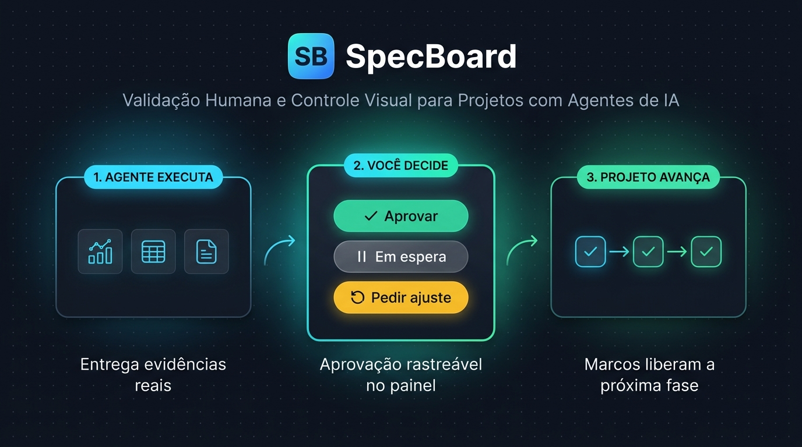
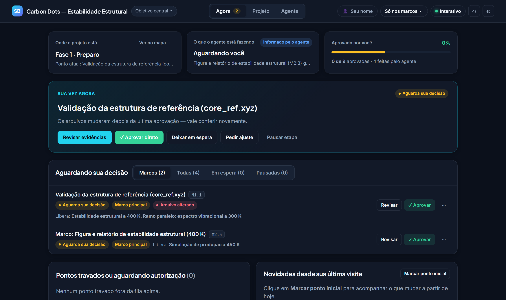
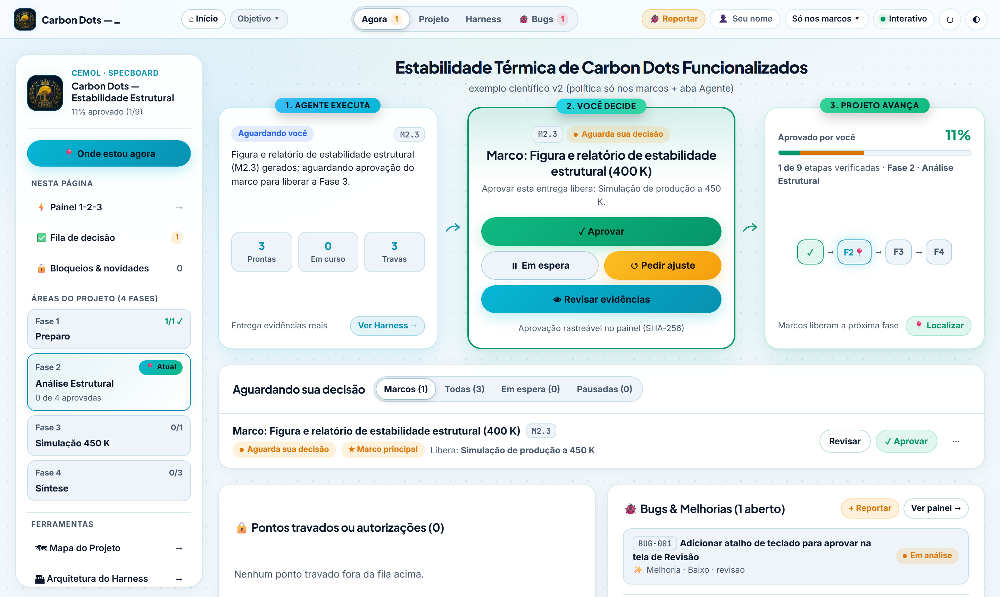
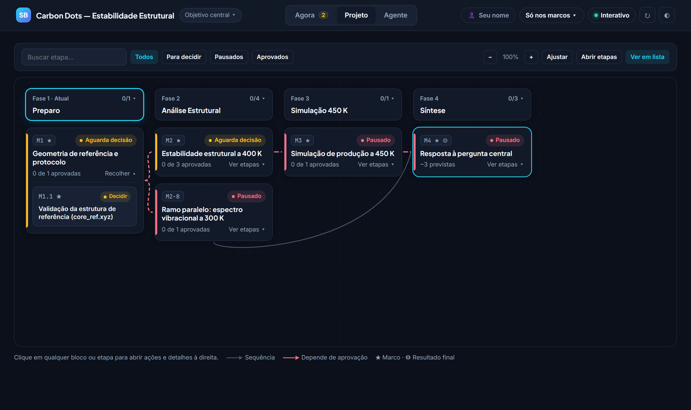
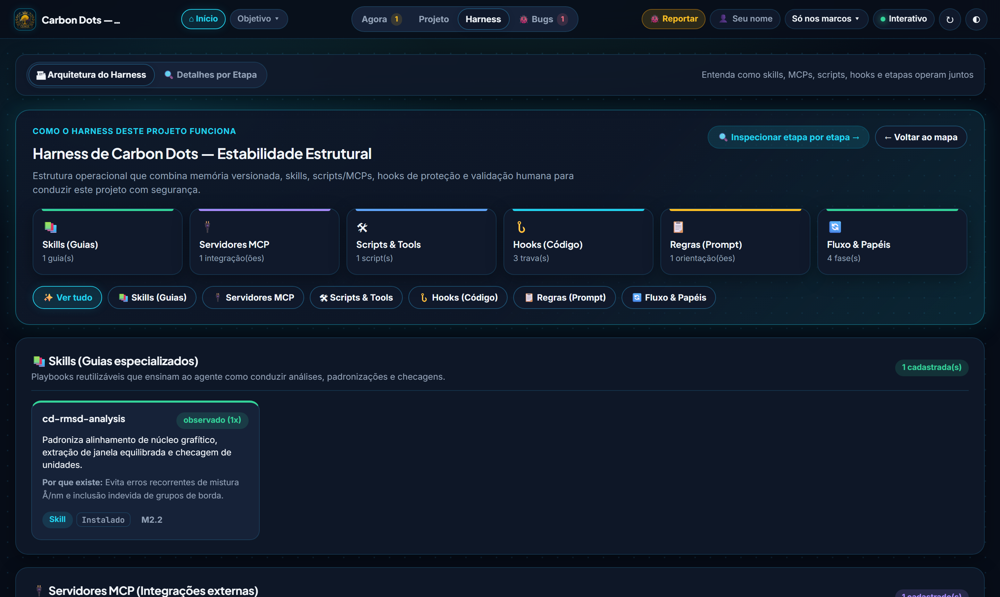
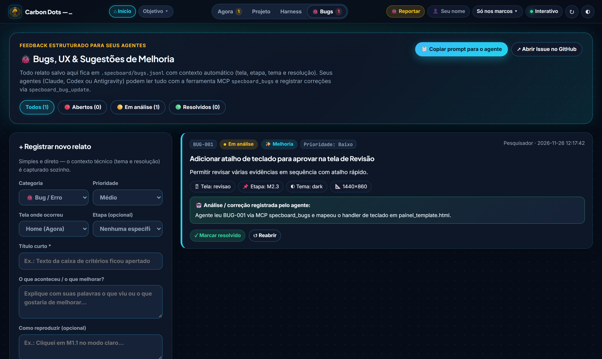

<div align="center">



<br /><br />


# SpecBoard

**Controle visual, validação humana e servidor MCP para projetos conduzidos por agentes de IA.**  
Desenvolvido pelo **CEMOL — Centro de Bioestabilidade Molecular do Cerrado (UEG)**.  
O agente executa e prepara evidências — **mas só você aprova, pausa, pede ajustes e libera a próxima fase**, direto no navegador.

[](https://www.python.org/)
[-059669?style=flat-square)](#comecar)
[](#marketplace)
[](#ssh)
[](LICENSE)

[Por que usar](#por-que-usar) · [Tour pelas telas](#telas) · [Plugin MCP & Marketplace](#marketplace) · [Políticas](#politicas) · [Comece em 60s](#comecar) · [Segurança](#seguranca) · [Comandos](#comandos)

</div>

<details>
<summary><b>English summary</b> (click to expand)</summary>

> **SpecBoard** is a zero-dependency Python 3 stdlib dashboard, **MCP server**, and multi-platform plugin (**Claude Code, OpenAI Codex, and Google Antigravity**) for AI-assisted modular and scientific projects, developed at **CEMOL (UEG)**.  
> It strictly separates **agent execution** (`executado`) from **human verification** (`verificado`), lets humans review inline evidence (PNG/SVG charts, CSV tables, Markdown reports) and click **Approve / Hold / Request changes / Pause** in a calm local or SSH-tunneled web UI, maps the entire **Agent Harness** (skills, MCPs, scripts, code hooks, prompt rules, and stage flow), and enforces SHA-256 byte integrity + TOCTOU (`HTTP 409`) protection with zero self-validation.

</details>

---

<a id="por-que-usar"></a>
## 💡 Por que o SpecBoard existe?

Quando um agente de IA trabalha em um projeto grande — uma pesquisa científica, um pipeline de dados ou um sistema complexo — acompanhar tudo apenas pelo chat rapidamente vira um emaranhado de mensagens. É fácil perder de vista **o que já foi validado de verdade** versus **o que o agente apenas disse que terminou**.

O **SpecBoard** transforma o plano do projeto em um painel vivo, legível e auditável:

| Sem SpecBoard (só no chat) | Com SpecBoard |
| :--- | :--- |
| O agente diz *"pronto!"* e já dispara a próxima fase cara sem conferência | **Executado ≠ Aprovado:** o agente registra o que fez, mas só você aprova e libera o próximo marco |
| Gráficos, tabelas e relatórios ficam espalhados em várias pastas | **Revisão contextual:** abre a figura, tabela CSV ou relatório na tela ao lado do critério e dos botões de decisão |
| Difícil lembrar em que fase o projeto parou depois de alguns dias | **Home guiada + 📍 Onde estou:** sidebar das áreas do projeto e botão que destaca exatamente a etapa atual |
| Arquivo editado depois da aprovação passa despercebido | **Rastreabilidade por SHA-256:** alterou um arquivo no disco, a aprovação anterior expira automaticamente |
| Impossível enxergar como o agente foi montado no projeto | **Arquitetura do Harness:** separa visualmente Skills, MCPs, Scripts, Hooks em código, Regras e Fluxo de Etapas |
| Cards cheios de scripts `.py`, hashes Git (`3dba70d`), `commits`, flags `--doc` e apelidos internos (`D50`, `Frente C`) | **Texto didático obrigatório em todos os cards:** títulos, resumos, *Como conferir*, blocos e Home explicam em linguagem humana *o quê*, *qual o resultado/regra* e *como conferir*; scripts, commits e códigos ficam no bloco recolhível *Detalhes técnicos* (validado por `validate --estrito` e MCP) |

---

<a id="telas"></a>
## 🖥️ Como funciona na prática (5 telas — Modo Escuro e Claro)

Toda a plataforma segue a mesma linguagem visual do banner acima — **grade arquitetural pontilhada, cartões com brilho ciano/esmeralda e botões em pílula** — tanto no **Modo Escuro** quanto no **Modo Claro** (alternância em 1 clique no topo), sempre com o botão rápido **`⌂ Início`**.

### 1. Tela _Agora_ (Home) — Fluxo vivo 1-2-3 + Sidebar de Áreas
A Home traz o fluxo vivo **1. Agente Executa → 2. Você Decide → 3. Projeto Avança** conectado aos dados reais do projeto, ao lado da barra lateral com a logo do grupo, fases clicáveis e botão **`📍 Onde estou agora`**.

**Modo Escuro (Dark):**


**Modo Claro (Light):**


---

### 2. Tela _Revisão_ — olhe a evidência real e decida ao lado
Em 2 colunas: à esquerda você confere **o que foi entregue**, os **critérios travados** e as **evidências inline** (gráficos PNG/SVG ampliáveis, tabelas CSV e relatórios Markdown); à direita você vê quais etapas serão liberadas e registra sua decisão.


---

### 3. Aba _Projeto_ — mapa interativo com botão `📍 Onde estou`
Exibe todas as fases lado a lado em um canvas com zoom, busca, modo **Ver em lista** e o botão **`📍 Onde estou`**, que centraliza e enfatiza a fase, o bloco e a etapa em foco. Clicar em qualquer bloco ou etapa abre um painel lateral enxuto com checklist recolhível e atalhos para as evidências.



---

### 4. Aba _Harness_ — entenda toda a engenharia do agente
Mostra de forma agradável e separada por entidade **como o harness do projeto foi construído**: **📚 Skills**, **🔌 Servidores MCP**, **🛠 Scripts Locais**, **🪝 Hooks/Guardrails em código**, **📋 Regras em texto** e **🔄 Fluxo de Etapas & Papéis** — além da inspeção detalhada etapa por etapa.



---

### 5. Aba _🐞 Bugs & Melhorias_ — reporte direto no painel para seus agentes analisarem
Botão rápido **`🐞 Reportar`** em todas as páginas (captura automaticamente tela, etapa, tema e resolução) + painel completo em `.specboard/bugs.jsonl`. Seus agentes leem os relatos via MCP (`specboard_bugs`), registram o diagnóstico/correção (`specboard_bug_update`) ou você copia o prompt estruturado em 1 clique.



---

<a id="marketplace"></a>
## 🔌 Plugin MCP e Marketplace (Claude Code, Codex e Antigravity)

Este repositório já está empacotado como **plugin + marketplace oficial com servidor MCP embutido** (`specboard/scripts/sb_mcp.py`, zero dependências) e **hook multi-plataforma contra autovalidação** (`block_verify_hook.py`) para os três ecossistemas:

### 1. Claude Code (Marketplace + Plugin + MCP + Hook)

```bash
claude plugin marketplace add fatioleg/specboard
claude plugin install specboard@specboard-marketplace
```

*(Manifestos incluídos: `.claude-plugin/marketplace.json`, `.claude-plugin/plugin.json`, `.mcp.json`, `hooks/hooks.claude.json` e `skills/specboard/SKILL.md`.)*

### 2. OpenAI Codex (Marketplace + Plugin + MCP + Hook)

```bash
codex plugin marketplace add https://github.com/fatioleg/specboard.git
# Em seguida, dentro do Codex, habilite em: /plugins -> SpecBoard (CEMOL)
```

Ou registre apenas o servidor MCP diretamente no Codex CLI:

```bash
codex mcp add specboard -- python /caminho/para/specboard/specboard/scripts/sb_mcp.py
```

*(Manifestos incluídos: `.agents/plugins/marketplace.json`, `.codex-plugin/plugin.json`, `.codex-plugin/mcp.json` e `hooks/hooks.codex.json`.)*

### 3. Google Antigravity (Plugin nativo + MCP + Hook)

```bash
agy plugin install https://github.com/fatioleg/specboard
```

Ou adicione diretamente ao seu `~/.gemini/config/mcp_config.json` (Windows / Linux / macOS):

```json
{
  "mcpServers": {
    "specboard": {
      "command": "python",
      "args": ["C:/caminho/para/specboard/specboard/scripts/sb_mcp.py"]
    }
  }
}
```

*(Manifestos incluídos: `plugin.json`, `mcp_config.json`, `hooks.json`, `rules/AGENTS.md` e `skills/specboard/SKILL.md`.)*

### Ferramentas expostas pelo servidor MCP (`specboard`)

| Ferramenta MCP | Para que serve | Pode aprovar pelo humano? |
| :--- | :--- | :-: |
| `specboard_status` | Resumo do projeto, fase atual, progresso aprovado e bloqueios | Não |
| `specboard_queue` | Fila priorizada de entregas aguardando decisão humana | Não |
| `specboard_gate` | Verifica se uma etapa está liberada ou bloqueada pela política | Não |
| `specboard_context` | Monta pacote mínimo versionado para retomada limpa de sessão | Não |
| `specboard_validate` | Valida `.specboard/estado.json`, contratos e arquivos de evidência | Não |
| `specboard_build` | Gera `.specboard/painel.html` (snapshot estático somente leitura) | Não |
| `specboard_harness` | Retorna o mapa completo de Skills, MCPs, Scripts, Hooks e Fluxo | Não |
| `specboard_trace_tool` | Registra uso observado de ferramentas em `execucoes.jsonl` (OTel) | Não |
| `specboard_bugs` | Lista bugs, problemas de UX e melhorias reportados em `bugs.jsonl` | Não |
| `specboard_bug_update` | Atualiza triagem e registra diagnóstico/correção do agente em um bug | Não |

> **Garantia estrutural:** o servidor MCP **não expõe** nenhuma ferramenta de aprovação, revisão ou troca de política. Decisões humanas acontecem somente no painel interativo (`serve`) ou no terminal humano.

---

<a id="politicas"></a>
## 🎛️ Escolha o nível de controle do seu projeto

Altere a qualquer momento diretamente pelo botão no topo do painel:

| Modo | Como funciona | Quando usar |
| :--- | :--- | :--- |
| **Livre (sem travas)**<br>`acompanhamento_livre` | O agente avança sem bloqueios; o painel continua diferenciando o que ele executou do que você aprovou. | Exploração inicial, protótipos rápidos e rascunhos. |
| **Só nos marcos** ⭐ *(padrão)*<br>`so_marcos` | Apenas os **marcos principais** (`marco: true`, no módulo ou em etapas específicas) precisam da sua aprovação para liberar dependentes; ramos paralelos seguem livres. | Projetos em fases e pesquisa científica (ex.: validar resultados-chave antes de rodar simulações caras). |
| **Etapa por etapa**<br>`por_etapa` | Cada etapa dependente aguarda sua aprovação individual antes de liberar a próxima. | Auditoria rigorosa passo a passo e entregas críticas. |

---

<a id="comecar"></a>
## 🚀 Comece em 60 segundos

### Requisitos
- **Python 3.11+** (Windows, Linux ou macOS)
- **Zero dependências externas** (biblioteca padrão do Python + HTML/CSS/JS puro)

### 1. Testar agora com o exemplo pronto (sem configurar nada)

```bash
git clone https://github.com/fatioleg/specboard.git
cd specboard
python specboard/scripts/specboard.py --dir examples/carbon_dots serve --open
```

### 2. Usar no seu próprio projeto

```bash
# 1. Inicializar .specboard/estado.json com a política desejada
python /caminho/para/specboard/specboard/scripts/specboard.py init --politica so_marcos

# 2. Validar e gerar snapshot estático offline
python /caminho/para/specboard/specboard/scripts/specboard.py validate
python /caminho/para/specboard/specboard/scripts/specboard.py build

# 3. Abrir o painel interativo no navegador (onde você revisa e aprova tudo)
python /caminho/para/specboard/specboard/scripts/specboard.py serve --port 8765 --open
```

<a id="ssh"></a>
### Uso em servidor remoto (SSH)

```bash
ssh -L 8765:127.0.0.1:8765 usuario@servidor \
  "cd ~/meu-projeto && python3 ~/specboard/specboard/scripts/specboard.py serve --port 8765"
```

Acesse `http://127.0.0.1:8765/` no seu navegador local para revisar figuras, tabelas e relatórios direto do servidor remoto e gravar aprovações atomicamente em `.specboard/verificacoes.jsonl`.

---

<a id="seguranca"></a>
## 🛡️ Por que confiar no painel?

1. **Zero autovalidação em Claude, Codex e Antigravity:** o hook [block_verify_hook.py](specboard/scripts/block_verify_hook.py) bloqueia qualquer tentativa de agentes aprovarem etapas, editarem `verificacoes.jsonl` ou iniciarem `serve` com escrita.
2. **Assinatura pelos bytes reais (SHA-256):** cada aprovação grava o hash SHA-256 composto do conteúdo dos arquivos de evidência; se qualquer arquivo mudar depois, a aprovação expira automaticamente.
3. **Proteção TOCTOU (`HTTP 409 Conflict`):** se um arquivo mudar no disco entre abrir a tela de Revisão e clicar em **Aprovar**, o servidor recusa aprovar às cegas e recarrega o conteúdo novo.
4. **100% local por padrão:** escuta somente em `127.0.0.1`, exige token CSRF + checagem de `Origin`, bloqueia *path traversal* (`403`) e serve evidências com `Content-Security-Policy` restritivo.

---

<a id="comandos"></a>
## 🧰 Referência rápida de comandos

*(Considere `SB = specboard/scripts/specboard.py`; passe `--dir <pasta>` quando rodar fora da raiz do projeto.)*

| Comando | Quem usa | Para que serve |
| :--- | :---: | :--- |
| `python SB init [--politica ...]` | Humano / Agente | Cria `.specboard/estado.json` e `.specboard/.gitignore` |
| `python SB validate [--estrito]` | Ambos | Valida estrutura, contratos travados, evidências e a clareza didática dos resumos (`--estrito` reprova jargão excessivo) |
| `python SB build [--open]` | Ambos | Gera `.specboard/painel.html` (snapshot estático offline) |
| `python SB serve [--port 8765] [--open]` | **Humano** | Abre o painel interativo local/SSH com revisão e gravação |
| `python SB queue [--todas]` | Ambos | Lista a fila priorizada de etapas aguardando decisão |
| `python SB gate <ETAPA> [--json]` | Agente | Checa se a etapa está liberada (`exit 0`) ou bloqueada (`exit 2`) |
| `python SB context <ETAPA> [--json]` | Agente | Monta pacote limpo e versionado para retomar sessão sem ruído |
| `python SB trace-tool <ETAPA> --tool ...` | Wrapper / Telemetria | Registra uso observado de skill/ferramenta/MCP (`execucoes.jsonl`) |
| `python SB lock <MOD>` / `amend <MOD> -j "..."` | Com aval humano | Trava critérios de aceitação do bloco e registra emendas visíveis |
| `python SB verify \| review \| request-changes <ETAPA>` | **Só humano** | Alternativa de terminal ao botão do painel |
| `python SB policy <MODO> -j "..."` | **Só humano** | Altera a regra de aprovação com justificativa auditável |

---

## 🧪 Testes e estrutura do repositório

```bash
python -m unittest discover -s tests -v
```

<details>
<summary><b>Ver estrutura completa de pastas e manifestos</b></summary>

```text
specboard/
├── plugin.json                    Manifesto nativo Antigravity / agent-plugins
├── mcp_config.json                Configuração MCP para Antigravity
├── hooks.json                     Hook PreToolUse nativo para Antigravity
├── .mcp.json                      Configuração MCP para Claude Code
├── .claude-plugin/                Marketplace e plugin do Claude Code (inclui icon.png)
├── .codex-plugin/                 Plugin e MCP do OpenAI Codex
├── .agents/plugins/               Marketplace do Codex / cross-agent
├── hooks/                         Hooks PreToolUse para Claude Code e Codex
├── rules/AGENTS.md                Regras consolidadas do plugin
├── skills/specboard/SKILL.md      Skill auto-descoberta nos marketplaces
├── docs/                          Banner hero, logo CEMOL e prévias do README
├── specboard/
│   ├── scripts/
│   │   ├── specboard.py           CLI unificado
│   │   ├── sb_core.py             Domínio, hashing SHA-256 v2, políticas, fila e Harness
│   │   ├── sb_server.py           Servidor local/SSH (CSRF, TOCTOU, evidências inline)
│   │   ├── sb_mcp.py              Servidor MCP stdio (8 ferramentas seguras, stdlib puro)
│   │   └── block_verify_hook.py   Hook multi-plataforma contra autovalidação
│   ├── assets/painel_template.html Interface única (Home com sidebar, Projeto, Revisão, Harness)
│   └── references/                Schema v2 e arquitetura do Harness/Agente
├── examples/                      Exemplo público sintético (carbon_dots) + fixture legada v1
└── tests/                         Suíte completa (core, políticas, servidor, MCP, plugins, hook, UI)
```

</details>

---

<div align="center">


<br />

Desenvolvido pelo **CEMOL — Centro de Bioestabilidade Molecular do Cerrado (UEG)**  
Distribuído sob a licença **[Apache License 2.0](LICENSE)**.

</div>
