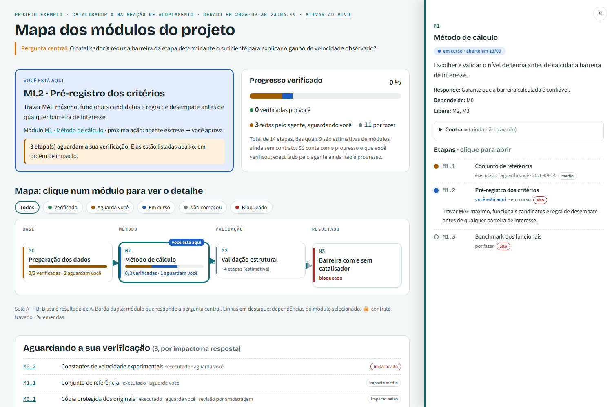

# specboard

**Painel de validação para projetos modulares conduzidos por agentes de IA.**
Uma skill para o [Claude Code](https://claude.com/claude-code) que converte a spec e o plano de um projeto em módulos, contratos pré-registrados e etapas verificáveis, e gera um painel HTML interativo. O painel mostra o ponto em que o projeto está, o que já foi feito e, principalmente, **o que ainda falta você conferir**.

> *English summary:* a Claude Code skill that turns a spec-driven, modular project plan into a single `estado.json` and an interactive HTML dashboard. The agent can only mark work as *executed*. Marking it *reviewed* or *verified* is a human act, done through an interactive terminal command and protected by a hook. Locked contracts carry a hash, any later change becomes a visible amendment, and a verification expires when the step changes afterwards.



*Painel do exemplo em [`examples/`](examples/): "você está aqui" em destaque, mapa clicável dos módulos com setas de dependência e a aba lateral com as etapas do módulo selecionado.*

---

## Sumário

- [Por que existe](#por-que-existe)
- [Os três princípios](#os-três-princípios)
- [Instalação](#instalação)
- [Uso rápido](#uso-rápido)
- [Fluxo completo](#fluxo-completo)
- [Ciclo de vida de uma etapa](#ciclo-de-vida-de-uma-etapa)
- [Comandos](#comandos)
- [O painel](#o-painel)
- [O arquivo `estado.json`](#o-arquivo-estadojson)
- [Contratos, travamento e emendas](#contratos-travamento-e-emendas)
- [Proteção contra autovalidação](#proteção-contra-autovalidação)
- [A regra da fila](#a-regra-da-fila)
- [Projetos em máquina remota](#projetos-em-máquina-remota)
- [Windows](#windows)
- [Limitações conhecidas](#limitações-conhecidas)
- [Estrutura do repositório](#estrutura-do-repositório)
- [Licença](#licença)

---

## Por que existe

Em projetos conduzidos por agentes, quem trava o andamento é o humano que precisa validar, não o agente que executa. O agente produz etapas mais rápido do que uma pessoa consegue conferi-las, e um painel que só celebra "etapas feitas" esconde exatamente esse acúmulo.

A specboard inverte o foco. O painel responde, nesta ordem:

1. **Onde estou?** O destaque "você está aqui" mostra a etapa atual e quem age a seguir.
2. **O que aguarda a minha verificação?** A fila vem ordenada pelo impacto na pergunta central do projeto.
3. **O que já foi feito e o que falta?** Uma linha do tempo e uma lista ordenada mostram quem age em cada item.

## Os três princípios

1. **Executado ≠ verificado.** O agente só leva uma etapa até `executado`. Marcar `revisado` ou `verificado` é um ato humano, registrado por um comando interativo em `.specboard/verificacoes.jsonl`.
2. **Denominador honesto.** O progresso conta todas as etapas planejadas, inclusive as estimadas para módulos ainda sem contrato. Só conta como progresso o que **você** verificou.
3. **Pré-registro.** Os critérios de aceitação e de abandono são escritos e travados (com hash) **antes** de ver os resultados. Uma mudança posterior vira emenda, exibida em destaque, e nunca uma edição silenciosa.

## Instalação

**Requisitos:** Claude Code e Python 3 (testado com 3.12 e 3.13). A skill não tem dependências: usa só a biblioteca padrão do Python.

```bash
git clone https://github.com/fatioleg/specboard.git
# copie a pasta da skill para o diretório de skills do Claude Code
cp -r specboard/specboard ~/.claude/skills/
```

No Windows (PowerShell):

```powershell
git clone https://github.com/fatioleg/specboard.git
Copy-Item -Recurse specboard\specboard "$env:USERPROFILE\.claude\skills\"
```

**Várias contas do Claude Code.** Se você usa mais de um diretório de configuração (`CLAUDE_CONFIG_DIR`, por exemplo `~/.claude-2`), copie a pasta para o `skills/` de cada um. Também funciona criar um link: `mklink /J` no Windows ou `ln -s` no Linux/macOS. Ao atualizar a skill, recopie e confira se as cópias são idênticas:

```bash
for d in ~/.claude ~/.claude-2; do (cd $d/skills/specboard && find . -type f -exec md5sum {} \; | sort -k2 | md5sum); done
```

Reinicie o Claude Code (ou abra uma sessão nova) para a skill aparecer.

## Uso rápido

Na raiz do projeto, dentro do Claude Code:

```
/specboard
```

A skill também dispara sozinha quando você pede algo como "monte o painel de validação deste projeto", "mapa dos módulos" ou "fila de revisão".

Na primeira vez, ela:

1. procura a spec e o plano (com o plugin oh-my-claudecode, em `.omc/specs/` e `.omc/plans/`) e, se houver dúvida, pergunta qual arquivo usar;
2. cria `.specboard/estado.json` a partir do plano;
3. valida, gera `.specboard/painel.html` e abre o painel no navegador;
4. lista as suposições que fez na conversão (impactos, estimativas, agrupamentos) para você aprovar ou corrigir;
5. instala o hook de proteção em `.claude/settings.json` e cria `.specboard/COMANDOS.txt` com os seus comandos já com o caminho certo.

## Fluxo completo

```
deep-interview ──► plano ──► specboard ──► execução etapa a etapa ──► você verifica
   (spec)          (OMC)     (estado.json   (agente: em_curso →        (terminal:
                              + painel)      executado + evidência)     review / verify)
```

1. **Montar o estado.** O agente converte cada unidade de entrega do plano em um módulo, com dependências, fase (coluna do mapa) e etapas. Módulos ainda não detalhados recebem `etapas_estimadas`. O módulo que responde a pergunta central é marcado com `resultado_final: true`.
2. **Instalar a proteção.** Isso é feito uma vez por projeto (veja [Proteção contra autovalidação](#proteção-contra-autovalidação)).
3. **Executar.** Ao começar uma etapa, o agente a marca `em_curso`. Ao terminar, marca `executado` e preenche `afirmacao` (o que estabeleceu), `verificacao` (como você confere em poucos minutos) e `evidencia`. Depois de cada mudança, roda `validate` e `build`.
4. **Travar o contrato antes dos resultados.** Antes da etapa que produz o resultado principal de um módulo, o agente confirma o contrato com você e roda `lock`.
5. **Verificar.** Você roda `review` ou `verify` no seu terminal, na ordem da fila.

## Ciclo de vida de uma etapa

```
                 agente                               humano (terminal interativo)
 pendente ──► em_curso ──► executado ──────────────► revisado ──► verificado
                 │                                       ▲             │
                 ▼                                       │             │ a etapa mudou depois?
             bloqueado                                   └─────────────┘ → a verificação expira
                                                                           e a etapa volta à fila
```

| Estado | Quem marca | Significado |
|---|---|---|
| `pendente` | agente | ainda não começou |
| `em_curso` | agente | em execução |
| `bloqueado` | agente | parada, com motivo em `bloqueio` |
| `executado` | agente | terminada, com afirmação, verificação e evidência; **ainda não é progresso** |
| `revisado` | humano | você leu a afirmação e o resumo |
| `verificado` | humano | você conferiu a evidência; só esse estado conta como progresso |

A verificação fica presa a um hash do `titulo`, da `afirmacao`, da `verificacao` e da `evidencia` da etapa. Se o agente alterar qualquer um deles depois que você verificou, a verificação **expira** e a etapa volta para a fila com o aviso "verificação expirada".

## Comandos

Rode os comandos na raiz do projeto. `SB` é o caminho do script, por exemplo `~/.claude/skills/specboard/scripts/specboard.py`.

| Comando | Quem roda | O que faz |
|---|---|---|
| `python SB init` | agente | cria `.specboard/estado.json` a partir do esqueleto |
| `python SB validate` | agente | checa as regras (abaixo); sai com código 1 se houver erro |
| `python SB build [--open]` | ambos | gera `.specboard/painel.html` (e abre no navegador) |
| `python SB queue` | ambos | lista a fila de verificação por impacto |
| `python SB lock <MOD>` | agente, com o seu aval | trava o contrato do módulo (pré-registro) |
| `python SB amend <MOD> -j "motivo"` | agente, com o seu aval | registra uma emenda num contrato travado |
| `python SB review <ETAPA>` | **só você** | marca como revisado |
| `python SB verify <ETAPA>` | **só você** | marca como verificado (a nota do que você conferiu é obrigatória) |

`review` e `verify` exigem um terminal interativo (`isatty`). Eles se recusam a rodar se a variável `CLAUDECODE` estiver definida e pedem que você digite o ID da etapa, o seu nome ou iniciais e uma nota. Todos os comandos aceitam `--dir <raiz>` para rodar fora da pasta do projeto.

## O painel

O painel é **gerado** a partir do `estado.json`; nunca edite o HTML. Ele é um arquivo único, que funciona offline e se adapta ao tema claro ou escuro do sistema. Contém:

- **Pergunta central** no topo.
- **Você está aqui:** a etapa atual, o que ela vai fazer e quem age a seguir. Quando a fila passa do limite, aparece também um alerta (veja [A regra da fila](#a-regra-da-fila)).
- **Progresso verificado:** uma barra empilhada (verificado, revisado, executado aguardando você, em curso) sobre o total, estimativas incluídas.
- **Mapa clicável:** uma coluna por fase, setas de dependência e filtros por status. Uma borda dupla marca o módulo que responde a pergunta central, 🔒 indica contrato travado e ✎ indica emendas.
- **Aba lateral de detalhe:** abre ao clicar num módulo, sem esconder o mapa. Mostra o objetivo, a parte da pergunta que o módulo responde, do que depende, o que libera, o contrato e as etapas. Cada etapa abre com um clique e mostra o que afirma, como conferir, a evidência, os registros humanos e o comando de verificação. Fecha com × ou Esc; no celular ocupa a tela inteira.
- **Aguardando a sua verificação:** a fila ordenada por impacto. Cada ID leva à etapa.
- **O que já foi feito:** uma linha do tempo por data (campo `data` das etapas).
- **O que falta, em ordem:** primeiro "você está aqui", depois as suas pendências, a fila, as próximas etapas e os módulos a planejar, cada item com quem age.
- **Como ler este painel:** a legenda dos estados e o glossário de siglas do projeto.

**Ao vivo.** Abra `painel.html#live` ou clique em "ativar ao vivo" para a página recarregar a cada 10 s e refletir cada `build`. Não há animações de propósito: o painel serve para decidir o que conferir, não para assistir ao agente trabalhar.

## O arquivo `estado.json`

A referência completa está em [`specboard/references/formato-estado.md`](specboard/references/formato-estado.md). Um exemplo completo está em [`examples/estado_completo.json`](examples/estado_completo.json).

Estrutura mínima:

```json
{
  "projeto": { "nome": "Meu projeto", "pergunta_central": "Qual pergunta o projeto responde?" },
  "fases": ["Base", "Método", "Resultado"],
  "modulos": [
    {
      "id": "M0", "titulo": "Preparação dos dados", "fase": "Base", "depende_de": [],
      "objetivo": "Dados de entrada auditados.",
      "contrato": {
        "pergunta": "Os dados estão completos e corretos?",
        "criterios_aceitacao": ["Todo arquivo com origem e checksum"],
        "criterio_abandono": "Se a fonte original não puder ser recuperada, rever o escopo."
      },
      "etapas": [
        { "id": "M0.1", "titulo": "Cópia protegida dos originais", "status": "executado", "impacto": "medio",
          "afirmacao": "Originais copiados sem alteração.",
          "verificacao": "Checksums em data/manifest.json coincidem com os originais.",
          "evidencia": ["data/manifest.json"] }
      ]
    },
    { "id": "M1", "titulo": "Resultado", "fase": "Resultado", "depende_de": ["M0"],
      "resultado_final": true, "etapas_estimadas": 5, "etapas": [] }
  ]
}
```

**Campos opcionais que tornam o painel didático:**

| Onde | Campo | Efeito no painel |
|---|---|---|
| projeto | `titulo`, `subtitulo` | título grande e linha de contexto |
| projeto | `voce_esta_aqui` | força a etapa em destaque (sem ele, é calculada) |
| projeto | `pendencias_humanas` | decisões que só você pode tomar, em "O que falta" |
| projeto | `glossario` | pares `[sigla, explicação]` em "Como ler" |
| projeto | `comando_humano` | prefixo real do comando (ex.: com `ssh -t …`) mostrado na fila |
| projeto | `limite_fila` | limite da fila (padrão 5) |
| projeto | `fontes` | de onde o estado foi convertido (rodapé) |
| módulo | `responde`, `quando`, `registro`, `bloqueio` | detalhe do módulo na aba lateral |
| etapa | `data` | alimenta a linha do tempo |
| etapa | `descricao`, `quem` | texto do "você está aqui" e quem age a seguir |

**Regras que o `validate` impõe:**

- `pergunta_central` é obrigatória.
- IDs de módulo e de etapa são únicos; uma dependência para um módulo inexistente é erro.
- O status no `estado.json` só pode ser `pendente`, `em_curso`, `executado` ou `bloqueado`. `revisado` e `verificado` vêm apenas de `verificacoes.jsonl`.
- O `impacto` deve ser `alto`, `medio` ou `baixo`.
- Uma etapa `executado` precisa de `afirmacao` e `verificacao`; sem `evidencia`, gera aviso.
- Um contrato travado e alterado sem `amend` é erro.
- Um módulo sem etapas nem estimativa gera aviso, porque fica fora do denominador.

**Bons e maus exemplos de `verificacao`:**

- ✅ "Abrir `out/resultados.csv`; a métrica X deve estar entre A e B e bater com a Tabela 2."
- ✅ "Rodar `pytest tests/test_parser.py`; os 12 testes passam."
- ❌ "Verificar se está correto." (não diz o quê nem como)
- ❌ "Revisar o código." (não tem critério de aprovação)

**Impacto.** Marque `alto` apenas nas etapas que, se estiverem erradas, mudam a resposta à pergunta central. Se tudo for alto, nada é. Etapas `baixo` podem usar `"revisao": "amostragem"`.

## Contratos, travamento e emendas

Cada módulo tem um contrato com `pergunta`, `criterios_aceitacao`, `criterio_abandono` e `parametros`.

- `lock <MOD>` exige os três primeiros campos preenchidos. Ele grava `travado_em` e um hash SHA-256 (12 caracteres) do contrato.
- Depois do travamento, qualquer mudança no contrato faz o `validate` falhar até que você rode `amend <MOD> -j "motivo"`. A emenda guarda a data, o hash anterior, o hash novo e a justificativa, e aparece em destaque no painel.
- A skill instrui o agente a **perguntar** o critério de abandono quando a spec não o traz, em vez de inventar um.

## Proteção contra autovalidação

Um hook `PreToolUse` (`scripts/block_verify_hook.py`) bloqueia, com código 2:

- qualquer comando Bash ou PowerShell cujo texto contenha `specboard … review|verify` ou cite `verificacoes.jsonl`;
- qualquer `Write`, `Edit` ou `MultiEdit` em `.specboard/verificacoes.jsonl`.

Para instalar, adicione ao `.claude/settings.json` do projeto (mescle com o que já houver) o caminho absoluto real:

```json
{
  "hooks": {
    "PreToolUse": [
      {
        "matcher": "Bash|PowerShell|Write|Edit|MultiEdit",
        "hooks": [{ "type": "command", "command": "python \"/caminho/para/specboard/scripts/block_verify_hook.py\"" }]
      }
    ]
  }
}
```

**Seja realista quanto ao alcance.** O hook, a exigência de terminal interativo e a checagem de `CLAUDECODE` evitam autovalidação **acidental**, não má-fé. Um agente determinado ainda poderia escrever o arquivo por outros meios. A defesa final é você revisar o `git diff` de `.specboard/`: só você escreve em `verificacoes.jsonl`.

O bloqueio vale para qualquer texto de comando que case com o padrão, inclusive testes do próprio agente. Isso é intencional.

## A regra da fila

Quando há mais de `limite_fila` etapas (padrão 5) aguardando a sua verificação, o agente **não abre etapas novas de impacto alto**. Produzir mais do que você consegue conferir só aumenta o acúmulo. O painel mostra o alerta no bloco "você está aqui".

É a regra mais importante da skill e também a primeira que você vai querer desligar quando estiver com pressa. Se precisar abrir uma exceção, peça explicitamente; o agente deve registrá-la.

## Projetos em máquina remota

Se o projeto vive num servidor (por exemplo, acessado por SSH), mantenha o `.specboard/` junto do projeto, no servidor:

1. Copie `scripts/` e `assets/` para o servidor (por exemplo, `~/.local/share/specboard/`).
2. Instale o hook nos dois lados: no `.claude/settings.json` local, de onde partem os comandos SSH, e no do servidor, se o Claude Code também rodar lá.
3. Rode os comandos humanos com `ssh -t`, para que o terminal seja interativo:

   ```bash
   ssh -t usuario@servidor "cd ~/projeto && python3 ~/.local/share/specboard/scripts/specboard.py verify M0.1"
   ```

4. Copie o `painel.html` para uma pasta local para abri-lo, e preencha `projeto.comando_humano` com o prefixo `ssh -t …`, para o painel mostrar o comando certo.

## Windows

- Use `python` (no Linux/macOS, geralmente `python3`). Tudo roda em PowerShell e Git Bash.
- O script força UTF-8 na saída. Mesmo assim, um console com página de código antiga pode exibir acentos errados numa listagem; o arquivo gravado fica correto.
- O caminho do hook no `settings.json` deve usar barras normais (`C:/Users/...`).
- Para capturar o painel em modo headless, o Edge ou o Chrome têm viewport mínima de cerca de 500 px. Uma captura em "390 px" sai recortada, sem que a página esteja quebrada.

## Limitações conhecidas

- A proteção contra autovalidação cobre acidentes, não má-fé (veja acima).
- A conversão do plano em `estado.json` é feita pelo agente e envolve julgamento (impactos, estimativas, agrupamentos). Por isso a skill exige que ele liste as suposições para você aprovar.
- As estimativas de etapas para módulos sem contrato são palpites até o contrato existir.
- O painel não edita nada: toda mudança passa pelo `estado.json` e pelos comandos.
- Testado em Windows 11 (PowerShell e Git Bash, Python 3.13) e Linux Mint 22.3 (Python 3.12).

## Estrutura do repositório

```
specboard/                     ← a skill (copie esta pasta para ~/.claude/skills/)
├── SKILL.md                   instruções que o Claude Code carrega
├── scripts/
│   ├── specboard.py           CLI: init, validate, lock, amend, queue, build, review, verify
│   └── block_verify_hook.py   hook PreToolUse contra autovalidação
├── assets/
│   ├── painel_template.html   template do painel (não editar por projeto)
│   └── estado_exemplo.json    esqueleto usado pelo init
└── references/
    └── formato-estado.md      referência completa do estado.json
examples/
├── estado_completo.json       exemplo com todos os campos opcionais
└── painel_completo.html       painel gerado a partir dele (abra no navegador)
docs/
└── painel.png                 captura usada neste README
```

## Licença

[Apache License 2.0](LICENSE).
