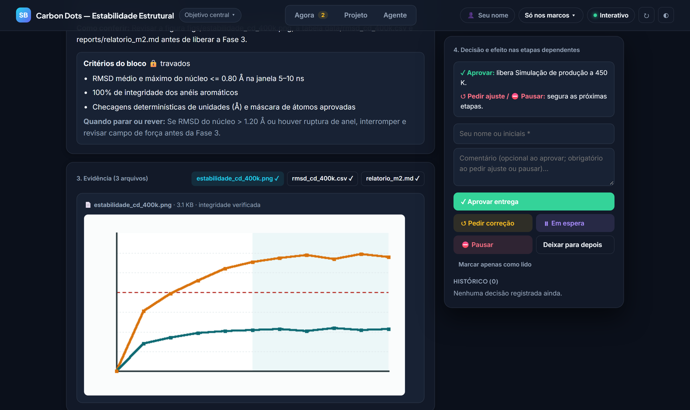

<div align="center">


<br /><br />

# SpecBoard

**Controle visual e validação humana para projetos conduzidos por agentes de IA.**  
O agente executa, gera resultados e prepara o caminho — **mas só você aprova, pausa, pede ajustes e libera a próxima fase**, tudo em um painel limpo no navegador.

[](https://www.python.org/)
[-059669?style=flat-square)](#comecar)
[](#ssh)
[](LICENSE)

[Por que usar](#por-que-usar) · [Tour pelas telas](#telas) · [Políticas de controle](#politicas) · [Comece em 60s](#comecar) · [Segurança](#seguranca) · [Comandos](#comandos)

</div>

<details>
<summary><b>English summary</b> (click to expand)</summary>

> **SpecBoard** is a zero-dependency Python 3 stdlib dashboard and validation harness for AI-assisted modular and scientific projects (compatible with Claude Code, Antigravity, Codex, or any CLI agent).  
> It strictly separates **agent execution** (`executado`) from **human verification** (`verificado`), lets humans review inline evidence (PNG/SVG charts, CSV tables, Markdown reports) and click **Approve / Hold / Request changes / Pause** directly in a local or SSH-tunneled browser UI, supports 3 project approval policies (`acompanhamento_livre`, `so_marcos` with granular milestones, `por_etapa`), and binds approvals to real file-byte SHA-256 hashes with TOCTOU (`HTTP 409`) protection.

</details>

---

<a id="por-que-usar"></a>
## 💡 Por que o SpecBoard existe?

Quando um agente de IA trabalha em um projeto grande — uma pesquisa científica, um pipeline de dados ou um sistema complexo — acompanhar tudo apenas pelo chat rapidamente vira um emaranhado de mensagens. É fácil perder de vista **o que já foi validado de verdade** versus **o que o agente apenas disse que terminou**.

O **SpecBoard** transforma o plano do projeto em um painel vivo, claro e auditável:

| Sem SpecBoard (só no chat) | Com SpecBoard |
| :--- | :--- |
| O agente diz *"pronto!"* e já dispara a próxima fase cara sem conferência | **Executado ≠ Aprovado:** o agente registra o que fez, mas só você aprova e libera o próximo marco |
| Gráficos, tabelas e relatórios ficam espalhados em várias pastas | **Revisão contextual:** abre a figura, tabela CSV ou relatório na tela ao lado do critério e dos botões de decisão |
| Difícil lembrar em que fase o projeto parou depois de alguns dias | **Tela _Agora_:** mostra em segundos onde você está, o que o agente faz e qual é a sua próxima ação |
| Arquivo editado depois da aprovação passa despercebido | **Rastreabilidade por SHA-256:** alterou um arquivo no disco, a aprovação anterior expira automaticamente |
| Histórico do agente mistura contexto antigo com regras atuais | **Aba _Agente_:** separa memória fixa, ferramentas usadas, proteções ativas e pacote limpo para retomar sessão |

---

<a id="telas"></a>
## 🖥️ Como funciona na prática (4 telas)

O SpecBoard organiza todo o acompanhamento em **4 visões integradas**, sem sobrecarga visual e com suporte a **tema escuro e claro em 1 clique**.

### 1. Tela _Agora_ — saiba o que fazer em 5 segundos
Reúne o estado atual do projeto, o que o agente está fazendo, o progresso **realmente aprovado por você**, a sua próxima ação em destaque e a fila priorizada com botões diretos (`Revisar`, `✓ Aprovar` e menu `⋯` para *Deixar em espera*, *Pedir ajuste*, *Pausar* ou *Retomar*).


---

### 2. Tela _Revisão_ — olhe a evidência real e decida ao lado
Ao clicar em **Revisar**, o painel abre em 2 colunas: à esquerda você confere **o que foi entregue**, os **critérios travados** e as **evidências inline** (gráficos PNG/SVG ampliáveis, tabelas CSV e relatórios Markdown); à direita você vê exatamente quais etapas serão liberadas e toma sua decisão.



---

### 3. Aba _Projeto_ — mapa visual estilo fluxograma
Mostra todas as fases lado a lado em um canvas interativo com zoom, busca e filtros. Linhas cinzas indicam sequência natural; linhas tracejadas vermelhas destacam dependências aguardando sua aprovação. Clicar em qualquer bloco ou etapa abre os detalhes e ações em um painel lateral sob demanda (também disponível em **Ver em lista**).


---

### 4. Aba _Agente_ — transparência técnica em 4 passos (1 painel por vez)
Permite inspecionar, etapa por etapa, exatamente como o agente está configurado — sem poluição na tela:
1. **Memória e regras** (o que entra fixo vs. como retomar em uma nova conversa sem poluição)
2. **Ferramentas** (distinguindo claramente o que foi *previsto*, *instalado* e *observado de fato* — exibe `sem registro` se não houver telemetria)
3. **Proteções** (separando travas automáticas em código de orientações em texto)
4. **Qualidade e revisão** (separando testes automáticos do agente da sua validação científica/humana)


---

<a id="politicas"></a>
## 🎛️ Escolha o nível de controle do seu projeto

Você pode escolher — e alterar a qualquer momento pelo topo do painel — o quanto o SpecBoard deve segurar o avanço automático do agente:

| Modo | Como funciona | Quando usar |
| :--- | :--- | :--- |
| **Livre (sem travas)**<br>`acompanhamento_livre` | O agente avança sem bloqueios; o painel continua diferenciando o que ele executou do que você aprovou. | Exploração inicial, protótipos rápidos e rascunhos. |
| **Só nos marcos** ⭐ *(padrão)*<br>`so_marcos` | Apenas os **marcos principais** (`marco: true`, no módulo ou em etapas específicas) precisam da sua aprovação para liberar dependentes; ramos paralelos seguem livres. | Projetos em fases e pesquisa científica (ex.: validar resultados-chave antes de rodar simulações caras). |
| **Etapa por etapa**<br>`por_etapa` | Cada etapa dependente aguarda sua aprovação individual antes de liberar a próxima. | Auditoria rigorosa passo a passo e entregas críticas. |

> **Regra de ouro:** em todos os modos — inclusive no *Livre* — o contador **"Aprovado por você"** nunca sobe sozinho. Só uma ação humana registrada aumenta o progresso verificado.

---

<a id="comecar"></a>
## 🚀 Comece em 60 segundos

### Requisitos
- **Python 3.11+** (Windows, Linux ou macOS)
- **Zero dependências externas** (apenas biblioteca padrão do Python + HTML/CSS/JS puro)

### 1. Instalar

```powershell
git clone https://github.com/fatioleg/specboard.git

# Opcional — instalar como skill no Claude Code (Windows):
Copy-Item -Recurse specboard\specboard "$env:USERPROFILE\.claude\skills\"
```

```bash
# Opcional — instalar como skill no Claude Code (Linux / macOS):
cp -r specboard/specboard ~/.claude/skills/
```

> O SpecBoard é **agnóstico de agente**: funciona com Claude Code, Antigravity, Codex ou qualquer fluxo via CLI (`gate`, `context`, `trace-tool`).

### 2. Testar agora com o exemplo pronto (sem criar nada)

O repositório já vem com um projeto de exemplo completo (gráfico PNG, tabela CSV, relatório Markdown, script e telemetria):

```bash
python specboard/scripts/specboard.py --dir examples/carbon_dots serve --open
```

### 3. Usar no seu próprio projeto

Na pasta raiz do seu projeto:

```bash
# 1. Inicializar o arquivo .specboard/estado.json com a política desejada
python /caminho/para/specboard/scripts/specboard.py init --politica so_marcos

# 2. Validar o arquivo e gerar uma cópia offline (somente leitura)
python /caminho/para/specboard/scripts/specboard.py validate
python /caminho/para/specboard/scripts/specboard.py build

# 3. Abrir o painel interativo no navegador (onde você revisa e aprova tudo)
python /caminho/para/specboard/scripts/specboard.py serve --port 8765 --open
```

<a id="ssh"></a>
### Uso em servidor remoto (SSH)

Se o seu projeto roda em uma workstation Linux ou cluster remoto, suba o servidor apenas em `127.0.0.1` na máquina remota e abra um túnel SSH:

```bash
ssh -L 8765:127.0.0.1:8765 usuario@servidor \
  "cd ~/meu-projeto && python3 ~/specboard/specboard/scripts/specboard.py serve --port 8765"
```

Depois acesse `http://127.0.0.1:8765/` no navegador do seu computador: você visualiza figuras, tabelas e relatórios direto do servidor remoto e grava aprovações atomicamente em `.specboard/verificacoes.jsonl`, sem precisar baixar HTML manualmente.

---

<a id="seguranca"></a>
## 🛡️ Por que confiar no painel?

1. **Zero autovalidação:** o hook [block_verify_hook.py](specboard/scripts/block_verify_hook.py) impede que agentes chamem comandos/endpoints humanos (`verify`, `review`, `request-changes`, `policy`, `serve` com escrita ou edição direta de `verificacoes.jsonl`).
2. **Assinatura pelos bytes reais (SHA-256):** cada aprovação grava o hash SHA-256 composto do conteúdo dos arquivos de evidência. Se qualquer arquivo mudar depois, o painel sinaliza **Arquivo alterado** e exige nova conferência.
3. **Proteção TOCTOU (`HTTP 409 Conflict`):** se um arquivo for modificado no disco entre o momento em que você abriu a tela de Revisão e o clique em **Aprovar**, o servidor recusa a gravação às cegas e recarrega o arquivo novo na tela.
4. **Segurança local por padrão:** o servidor escuta somente em `127.0.0.1`, exige token CSRF de sessão e checagem de `Origin` em toda escrita, bloqueia *path traversal* (`403`) e serve evidências com cabeçalho restritivo (`Content-Security-Policy`).

---

<a id="comandos"></a>
## 🧰 Referência rápida de comandos

*(Considere `SB = specboard/scripts/specboard.py`; passe `--dir <pasta>` quando rodar fora da raiz do projeto.)*

| Comando | Quem usa | Para que serve |
| :--- | :---: | :--- |
| `python SB init [--politica ...]` | Humano / Agente | Cria `.specboard/estado.json` e `.specboard/.gitignore` |
| `python SB validate` | Ambos | Valida estrutura, contratos travados e presença das evidências |
| `python SB build [--open]` | Ambos | Gera `.specboard/painel.html` (snapshot estático offline) |
| `python SB serve [--port 8765] [--open]` | **Humano** | Abre o painel interativo local/SSH com revisão e gravação |
| `python SB queue [--todas]` | Ambos | Lista a fila priorizada de etapas aguardando decisão |
| `python SB gate <ETAPA> [--json]` | Agente | Checa se a etapa está liberada (`exit 0`) ou bloqueada (`exit 2`) |
| `python SB context <ETAPA> [--json]` | Agente | Monta pacote limpo e versionado para retomar sessão sem ruído |
| `python SB trace-tool <ETAPA> --tool ...` | Wrapper / Telemetria | Registra uso observado de skill/ferramenta/MCP (`execucoes.jsonl`) |
| `python SB lock <MOD>` / `amend <MOD> -j "..."` | Com aval humano | Trava critérios de aceitação do bloco e registra emendas visíveis |
| `python SB verify \| review \| request-changes <ETAPA>` | **Só humano** | Alternativa de terminal ao botão do painel |
| `python SB policy <MODO> -j "..."` | **Só humano** | Altera a regra de aprovação com justificativa auditável |

---

## 🧪 Testes e estrutura do projeto

Para executar toda a suíte automatizada (core, hashing SHA-256, políticas, servidor HTTP, proteção TOCTOU, hook de segurança e renderização da UI):

```bash
python -m unittest discover -s tests -v
```

<details>
<summary><b>Ver estrutura completa de pastas e arquivos</b></summary>

```text
specboard/
├── docs/                          Imagens didáticas e prévias do README
├── specboard/
│   ├── SKILL.md                   Instruções da skill para agentes
│   ├── scripts/
│   │   ├── specboard.py           CLI unificado (init, validate, build, serve, gate, context...)
│   │   ├── sb_core.py             Domínio, hashing SHA-256 v2, políticas, fila e contexto limpo
│   │   ├── sb_server.py           Servidor local/SSH (Python stdlib, CSRF, TOCTOU, evidências inline)
│   │   └── block_verify_hook.py   Hook PreToolUse contra autovalidação por agentes
│   ├── assets/
│   │   ├── painel_template.html   Interface web única (Agora, Projeto, Revisão, Agente)
│   │   └── estado_exemplo.json    Modelo inicial pronto para copiar
│   └── references/
│       ├── formato-estado.md      Especificação completa do schema v2 + retrocompatibilidade v1
│       └── arquitetura-agente.md  Guia detalhado da aba Agente
├── examples/
│   ├── carbon_dots/               Exemplo completo v2 (PNG, CSV, Markdown, script e telemetria)
│   ├── estado_completo.json       Fixture legada v1 preservada para regressão
│   └── painel_completo.html       Painel v2 gerado sobre o exemplo legado
└── tests/                         20 testes automatizados (unittest stdlib)
```

</details>

---

## 📄 Licença

Distribuído sob a licença **[Apache License 2.0](LICENSE)**.
